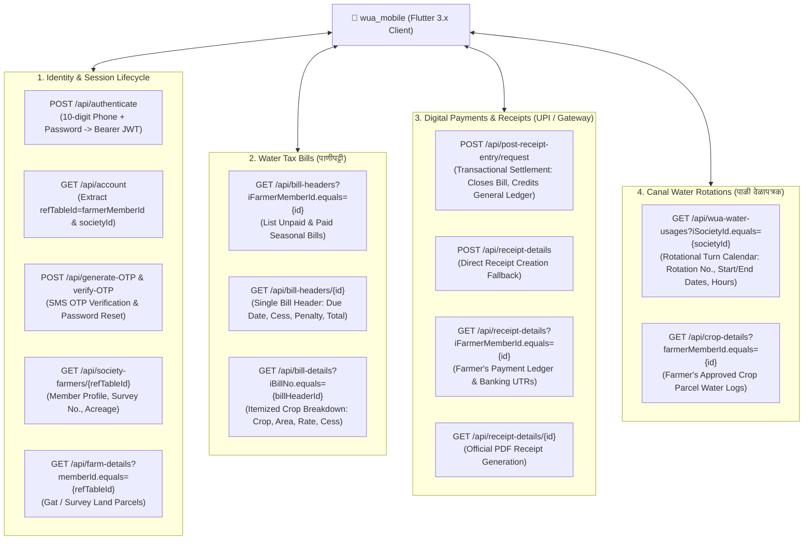

# Complete Production API Integration Specification: `wua_mobile` $\leftrightarrow$ `wrd_backend`
**Water Resources Department (WRD) — Farmer / Sabhasad Mobile Application**
*Authoritative Reference: `wrd_backend` Spring Boot REST Controllers, DTOs, Criteria & Services*
*Target Client: `wua_mobile` (Flutter 3.x Production App)*
*Document Version: 2.0 (Deep Code Review & Field Audit) • Date: 2026-11-23*

---

## 1. Executive Summary & Production Architecture

This document provides the definitive, production-grade API integration specification for connecting the **`wua_mobile`** Flutter app directly to the **`wrd_backend`** Spring Boot REST microservices.

### The 4 Core Farmer Operational Pillars


---

## 2. Spring Data Criteria & Pagination Standards

All `GET` endpoints in `wrd_backend` use JHipster / Spring Data JPA Criteria filtering:

1. **Filtering Syntax**:
   - Exact match: `fieldName.equals=value` (e.g. `iFarmerMemberId.equals=501`)
   - Boolean filter: `isPaymentDone.equals=false`
   - Numeric range: `nBillAmount.greaterThanOrEqual=100`
2. **Pagination Syntax**:
   - Zero-indexed page: `page=0`
   - Page size: `size=20`
   - Sorting: `sort=id,desc` or `sort=dBillDate,desc`
3. **Pagination Headers**:
   - Total records count is returned by backend in the HTTP response header: **`X-Total-Count`**.
   - Page navigation links are returned in the **`Link`** response header.

---

## 3. Deep Dive: Category 1 — Authentication, OTP & Farmer Profile

### 1.1 `POST /api/authenticate` (Farmer Sign-In)
- **Controller**: `com.techvg.wrd.web.rest.AuthenticateController`
- **Security**: Public (No JWT required)
- **Purpose**: Authenticates the farmer using their 10-digit mobile number and returns a signed JWT token.

#### Request Headers
```http
Content-Type: application/json
Accept: application/json
```

#### Request Body
```json
{
  "username": "9876543210",
  "password": "Farmer@123",
  "rememberMe": true
}
```

#### Response (200 OK)
```json
{
  "id_token": "eyJhbGciOiJIUzUxMiJ9.eyJzdWIiOiI5ODc2NTQzMjEwIiwiYXV0aCI6IlNBQkhBU0FEX09OTFkiLCJleHAiOjE3NjM5ODIwMDB9..."
}
```

---

### 1.2 `GET /api/account` (Account & Agricultural Binding)
- **Controller**: `com.techvg.wrd.web.rest.AccountResource`
- **Security**: Bearer JWT (`SABHASAD_ONLY`)
- **Purpose**: Resolves user profile, extracts `societyId`, and crucially provides the polymorphic agricultural link: `refTable="SocietyFarmer"` and `refTableId` (e.g. `501`).

#### Response (200 OK)
```json
{
  "id": 2101,
  "username": "9876543210",
  "firstName": "रमेश",
  "lastName": "पाटील",
  "mobileNo": "9876543210",
  "email": "farmer@wua.gov.in",
  "societyId": 1503,
  "refTable": "SocietyFarmer",
  "refTableId": 501,
  "status": "A",
  "langKey": "mr",
  "authorities": [
    "SABHASAD_ONLY",
    "MEMBER_LIST_VIEW",
    "WATER_RECEIVED_LIST_VIEW",
    "WATER_USED_LIST_VIEW"
  ],
  "roles": ["सभासद (शेतकरी)"]
}
```

---

### 1.3 `POST /api/generate-OTP` (SMS OTP Dispatch)
- **Controller**: `com.techvg.wrd.web.rest.OTPResource`
- **Security**: Public
- **Purpose**: Generates a 6-digit numeric OTP and sends it to the farmer's registered mobile number via SMS gateway.

#### Request
```http
POST /api/generate-OTP?username=9876543210
```

#### Response (200 OK)
`HTTP 200 OK (Empty Body)`

---

### 1.4 `POST /api/verify-OTP` (SMS OTP Verification)
- **Controller**: `com.techvg.wrd.web.rest.OTPResource`
- **Security**: Public
- **Purpose**: Validates the 6-digit OTP entered by the farmer.

#### Request
```http
POST /api/verify-OTP?username=9876543210&otp=582914
```

#### Response (200 OK)
```json
true
```

---

### 1.5 `POST /api/change-password` (Password Recovery)
- **Controller**: `com.techvg.wrd.web.rest.OTPResource`
- **Security**: Public
- **Purpose**: Updates the user's password in the database upon successful OTP verification.

#### Request
```http
POST /api/change-password?username=9876543210&newPassword=NewPass%40123
```

#### Response (200 OK)
```json
true
```

---

### 1.6 `GET /api/society-farmers/{id}` (Farmer Member Record)
- **Controller**: `com.techvg.wrd.web.rest.SocietyFarmerResource`
- **Path Parameter**: `{id}` = `refTableId` (e.g. `501`)
- **Security**: Bearer JWT (`MEMBER_LIST_VIEW`)
- **Purpose**: Fetches the farmer's landholding details, Gat number, crop pattern, and total balance.

#### Response (200 OK)
```json
{
  "id": 501,
  "iSocietyId": 1503,
  "sName": "रमेश रंगनाथ पाटील",
  "sRegistrationNo": "MEM-1503-0501",
  "dRegistrationDate": "2023-01-15T08:30:00Z",
  "sSurveyNo": "Gat No. 142/2A",
  "sVillage": "शिरूर",
  "nFarmArea": 2.50,
  "sTypeOfCrop": "ऊस (Sugarcane)",
  "sIrrigationMethod": "ठिबक सिंचन (Drip)",
  "sWaterSource": "कॅनल (Canal Minor 3)",
  "nTotalBalance": 1450.00,
  "sStatus": "A"
}
```

---

### 1.7 `GET /api/farm-details?memberId.equals={id}` (Land Survey Parcels)
- **Controller**: `com.techvg.wrd.web.rest.FarmDetailsResource`
- **Security**: Bearer JWT (`SABHASAD_ONLY`)
- **Purpose**: Fetches all individual farm land parcels (गट क्रमांक) owned by the farmer.

#### Response (200 OK)
```json
[
  {
    "id": 812,
    "village": "शिरूर",
    "surveyNo": "142/2A",
    "area": 1.50,
    "source": "Canal",
    "rateType": "Perennial",
    "motor": 5,
    "status": "A",
    "memberId": 501,
    "societyId": 1503
  },
  {
    "id": 813,
    "village": "शिरूर",
    "surveyNo": "145/1B",
    "area": 1.00,
    "source": "Lift",
    "rateType": "Seasonal",
    "motor": 3,
    "status": "A",
    "memberId": 501,
    "societyId": 1503
  }
]
```

---

## 4. Deep Dive: Category 2 — Water Tax Bills (`bills` feature)

### 2.1 `GET /api/bill-headers` (Farmer Bill List)
- **Controller**: `com.techvg.wrd.web.rest.BillHeaderResource`
- **Security**: Bearer JWT (Requires adding `SABHASAD_ONLY` to Line 158 of `BillHeaderResource.java`)
- **Query Parameters**:
  - `iFarmerMemberId.equals=501` (Mandatory for farmer)
  - `isPaymentDone.equals=false` (To filter unpaid bills)
  - `page=0&size=20&sort=id,desc`

#### Response (200 OK)
```json
[
  {
    "id": 1042,
    "iFarmerMemberId": 501,
    "iSocietyId": 1503,
    "dBillDate": "2026-10-15T00:00:00Z",
    "dDueDate": "2026-11-30T00:00:00Z",
    "sFiscalYear": "2026-2027",
    "sSeason": "RABI",
    "nBillAmount": 1450.00,
    "nPaidAmount": 0.00,
    "nLocalTax": 120.00,
    "nPenalty": 50.00,
    "nPreviousBalance": 0.00,
    "isPaymentDone": false,
    "sStatus": "A"
  }
]
```

---

### 2.2 `GET /api/bill-headers/{id}` (Bill Header Details)
- **Controller**: `com.techvg.wrd.web.rest.BillHeaderResource`
- **Security**: Bearer JWT (`SABHASAD_ONLY` allowed on Line 189)
- **Path Parameter**: `{id}` = Bill ID (e.g. `1042`)

#### Response (200 OK)
```json
{
  "id": 1042,
  "iFarmerMemberId": 501,
  "iSocietyId": 1503,
  "dBillDate": "2026-10-15T00:00:00Z",
  "dDueDate": "2026-11-30T00:00:00Z",
  "sFiscalYear": "2026-2027",
  "sSeason": "RABI",
  "nBillAmount": 1450.00,
  "nPaidAmount": 0.00,
  "nLocalTax": 120.00,
  "nPenalty": 50.00,
  "nPreviousBalance": 0.00,
  "isPaymentDone": false,
  "sStatus": "A"
}
```

---

### 2.3 `GET /api/bill-details?iBillNo.equals={billHeaderId}` (Crop-Wise Line Items)
- **Controller**: `com.techvg.wrd.web.rest.BillDetailsResource`
- **Security**: Bearer JWT (`SABHASAD_ONLY` allowed on Line 96)
- **Query Parameter**: `iBillNo.equals=1042`

#### Response (200 OK)
```json
[
  {
    "id": 2041,
    "iBillNo": 1042,
    "iFarmerMemberId": 501,
    "iSocietyId": 1503,
    "sCrop": "ऊस (Sugarcane)",
    "nIrrigatedArea": 1.20,
    "sSeason": "RABI",
    "sRotation": "1",
    "nRate": 900.00,
    "nAmount": 1080.00,
    "nLocalTax": 90.00,
    "nPenalty": 0.00,
    "totalAmount": 1170.00,
    "isPaymentDone": false
  },
  {
    "id": 2042,
    "iBillNo": 1042,
    "iFarmerMemberId": 501,
    "iSocietyId": 1503,
    "sCrop": "गहू (Wheat)",
    "nIrrigatedArea": 0.50,
    "sSeason": "RABI",
    "sRotation": "1",
    "nRate": 440.00,
    "nAmount": 220.00,
    "nLocalTax": 30.00,
    "nPenalty": 0.00,
    "totalAmount": 250.00,
    "isPaymentDone": false
  }
]
```

---

## 5. Deep Dive: Category 3 — Payments & Digital Settlement (`payments` feature)

### 3.1 Primary Settlement Engine: `POST /api/post-receipt-entry/request`
This is the **true transactional settlement method** in `wrd_backend`. It executes the full business lifecycle:
1. Adjusts unpaid balance across all `BillDetails`.
2. Flips `BillDetails.isPaymentDone = true` and `CropDetails.isPaymentDone = true`.
3. Creates a `ReceiptDetails` record with the banking UTR.
4. Creates `ReceiptAllocationDetails` connecting payment to season and crop.
5. Invokes `glGenerationService` to write debit/credit vouchers to the society's General Ledger!

- **Controller**: `com.techvg.wrd.web.rest.PostReceiptEntryResource`
- **Security**: Requires adding `SABHASAD_ONLY` to Line 54 of `PostReceiptEntryResource.java`.

#### Request Payload
```json
{
  "societyId": 1503,
  "farmerMemberId": 501,
  "receiptAmount": 1450.00,
  "tranDate": "2026-11-23T11:30:00Z",
  "fiscalYear": "2026-2027",
  "season": "RABI",
  "instrumentType": "UPI",
  "transactionType": "CREDIT",
  "bankLedgerId": 1,
  "transactionRefNo": "UPI/332158921102/PAYTM",
  "remark": "Paid via wua_mobile PhonePe UPI",
  "userId": 2101
}
```

#### Response (200 OK)
```json
"Success"
```

---

### 3.2 Direct Receipt Fallback: `POST /api/receipt-details`
If `post-receipt-entry` requires admin approval, `wua_mobile` can record the digital receipt directly via `ReceiptDetailsResource`, which has **no restrictive `@PreAuthorize` constraints**.

- **Controller**: `com.techvg.wrd.web.rest.ReceiptDetailsResource`
- **Security**: Authenticated JWT

#### Request Payload
```json
{
  "iFarmerMemberId": 501,
  "iSocietyId": 1503,
  "billNo": 1042,
  "nAmount": 1450.00,
  "dReceiptDate": "2026-11-23T11:30:00Z",
  "dValueDate": "2026-11-23T11:30:00Z",
  "sFiscalYear": "2026-2027",
  "season": "RABI",
  "sInstrumentType": "UPI",
  "sTransactionType": "CREDIT",
  "sTransactionId": "UPI/332158921102/PAYTM",
  "sStatus": "A",
  "sRemarks": "Settled via wua_mobile PhonePe UPI"
}
```

#### Response (201 Created)
```json
{
  "id": 4091,
  "iFarmerMemberId": 501,
  "iSocietyId": 1503,
  "billNo": 1042,
  "dReceiptDate": "2026-11-23T11:30:00Z",
  "nAmount": 1450.00,
  "sInstrumentType": "UPI",
  "sTransactionType": "CREDIT",
  "sTransactionId": "UPI/332158921102/PAYTM",
  "sStatus": "A"
}
```

---

### 3.3 `GET /api/receipt-details?iFarmerMemberId.equals={id}` (Payment History & Receipts)
- **Controller**: `com.techvg.wrd.web.rest.ReceiptDetailsResource`
- **Security**: Bearer JWT (`SABHASAD_ONLY`)
- **Query Parameters**: `iFarmerMemberId.equals=501&sort=dReceiptDate,desc`

#### Response (200 OK)
```json
[
  {
    "id": 4091,
    "iFarmerMemberId": 501,
    "iSocietyId": 1503,
    "billNo": 1042,
    "dReceiptDate": "2026-11-23T11:30:00Z",
    "nAmount": 1450.00,
    "sInstrumentType": "UPI",
    "sTransactionId": "UPI/332158921102/PAYTM",
    "sStatus": "A",
    "sRemarks": "Settled via wua_mobile PhonePe UPI"
  }
]
```

---

## 6. Deep Dive: Category 4 — Canal Water Rotations & Crop Allocation (`water_usage` feature)

### 4.1 `GET /api/wua-water-usages` (Rotational Turn Calendar)
- **Controller**: `com.techvg.wrd.web.rest.WUAWaterUsageResource`
- **Security**: Bearer JWT (`WATER_RECEIVED_LIST_VIEW`, `SABHASAD_ONLY`)
- **Query Parameters**: `iSocietyId.equals=1503&sort=startDate,asc`

#### Response (200 OK)
```json
[
  {
    "id": 312,
    "iSocietyId": 1503,
    "sSeason": "RABI",
    "sRotation": "3",
    "startDate": "2026-11-28T00:00:00Z",
    "endDate": "2026-12-04T00:00:00Z",
    "waterStartTime": "08:00",
    "waterEndTime": "20:00",
    "totalDays": 6.0,
    "totalHours": 72.0,
    "cumecs": 3.5,
    "sStatus": "A",
    "sRemarks": "Canal Minor-3 Rotation Turn #3"
  }
]
```

---

### 4.2 `GET /api/crop-details` (Farmer's Crop Water Allocation)
- **Controller**: `com.techvg.wrd.web.rest.CropDetailsResource`
- **Security**: Bearer JWT (`WATER_USED_LIST_VIEW`, `SABHASAD_ONLY`)
- **Query Parameter**: `farmerMemberId.equals=501`

#### Response (200 OK)
```json
[
  {
    "id": 5120,
    "memberId": 501,
    "societyId": 1503,
    "fiscalYear": "2026-2027",
    "season": "RABI",
    "rotation": "2",
    "surveyNo": "142/2A",
    "crop": "ऊस (Sugarcane)",
    "area": 1.20,
    "source": "Canal",
    "rateValue": 900.0,
    "amount": 1080.0,
    "approvalStatus": "APPROVED",
    "billGenerated": "Y"
  }
]
```

---

## 7. Model Deserialization Gap Analysis: `wrd_backend` $\rightarrow$ `wua_mobile`

Below is the exact side-by-side mapping between the backend's JSON keys and the mobile client's Dart model fields:

### 1. Bills Feature Mapping (`BillHeaderDTO` $\rightarrow$ `BillModel`)

| `wrd_backend` JSON Key | Existing `BillModel` Field | Recommended Mapper Adjustment in `BillModel.fromJson` |
|:---|:---|:---|
| `id` | `id` | `_parseString(json['id'])` |
| `id` / `billNo` | `billNumber` | `json['billNumber'] ?? 'BILL-${json['id']}'` |
| `isPaymentDone` | `status` | `(json['isPaymentDone'] == true) ? 'PAID' : 'PENDING'` |
| `nBillAmount` | `totalAmount` | `(json['nBillAmount'] ?? json['totalAmount'] as num?)?.toDouble() ?? 0.0` |
| `nPaidAmount` | `paidAmount` | `(json['nPaidAmount'] as num?)?.toDouble() ?? 0.0` |
| `nLocalTax` | `taxes` | `(json['nLocalTax'] as num?)?.toDouble() ?? 0.0` |
| `nPenalty` | `penalties` | `(json['nPenalty'] as num?)?.toDouble() ?? 0.0` |
| `nPreviousBalance` | `outstandingAmount` | `(json['nPreviousBalance'] as num?)?.toDouble() ?? 0.0` |
| `dBillDate` | `billDate` | `DateTime.tryParse(json['dBillDate'] ?? '')` |
| `dDueDate` | `dueDate` | `DateTime.tryParse(json['dDueDate'] ?? '')` |
| `sSeason` | `season` | `json['sSeason'] ?? 'Rabi Season'` |

---

### 2. Payments Feature Mapping (`ReceiptDetailsDTO` $\rightarrow$ `PaymentModel`)

| `wrd_backend` JSON Key | Existing `PaymentModel` Field | Recommended Mapper Adjustment in `PaymentModel.fromJson` |
|:---|:---|:---|
| `id` | `id` | `_parseString(json['id'])` |
| `sTransactionId` / `id` | `paymentNumber` | `json['sTransactionId'] ?? 'REC-${json['id']}'` |
| `nAmount` | `amount` | `(json['nAmount'] ?? json['amount'] as num?)?.toDouble() ?? 0.0` |
| `dReceiptDate` | `paymentDate` | `DateTime.tryParse(json['dReceiptDate'] ?? '') ?? DateTime.now()` |
| `sInstrumentType` | `paymentMode` | `json['sInstrumentType'] ?? 'UPI'` |
| `billNo` | `billId` | `_parseStringOrNull(json['billNo'])` |
| `sStatus` | `status` | `(json['sStatus'] == 'A') ? 'SUCCESS' : 'PENDING'` |
| `sTransactionId` | `gatewayTransactionId` | `json['sTransactionId']` |

---

### 3. Rotations Feature Mapping (`WUAWaterUsageDTO` $\rightarrow$ `IrrigationTurnModel`)

| `wrd_backend` JSON Key | `IrrigationTurnModel` Field | Adjustment in `IrrigationTurnModel.fromJson` |
|:---|:---|:---|
| `id` | `id` | `_parseString(json['id'])` |
| `sRotation` | `turnNumber` | `int.tryParse(json['sRotation']?.toString() ?? '1') ?? 1` |
| `startDate` + `waterStartTime` | `scheduledStartTime` | Combine `startDate` (e.g. `2026-11-28`) with `waterStartTime` (`08:00`). |
| `endDate` + `waterEndTime` | `scheduledEndTime` | Combine `endDate` with `waterEndTime` (`20:00`). |
| `totalHours` | `durationHours` | `(json['totalHours'] as num?)?.toDouble() ?? 12.0` |
| `sRemarks` | `outletNo` / `notes` | `json['sRemarks'] ?? 'Canal Minor Outlet'` |

---

## 8. Backend `@PreAuthorize` Security Action Items

Before deploying to live production, verify and apply the following permissions in `wrd_backend`:

```diff
--- BillHeaderResource.java
+++ BillHeaderResource.java
@@ -157,7 +157,7 @@
     @GetMapping("")
-    @PreAuthorize("hasAnyAuthority('SUPER_ADMIN_AND_SACHIV_AND_SANCHALAK_ONLY')")
+    @PreAuthorize("hasAnyAuthority('SUPER_ADMIN_AND_SACHIV_AND_SANCHALAK_ONLY', 'SABHASAD_ONLY')")
     public ResponseEntity<List<BillHeaderDTO>> getAllBillHeaders(
         BillHeaderCriteria criteria,

--- PostReceiptEntryResource.java
+++ PostReceiptEntryResource.java
@@ -53,7 +53,7 @@
     @PostMapping("/request")
-    @PreAuthorize("hasAnyAuthority('SUPER_ADMIN_AND_SACHIV_ONLY')")
+    @PreAuthorize("hasAnyAuthority('SUPER_ADMIN_AND_SACHIV_ONLY', 'SABHASAD_ONLY')")
     public ResponseEntity<String> postReceiptEntryRequeset(@RequestBody PostReceiptEntryRequestDTO requestParam) {
```

---

## 9. Step-by-Step Production Cutover Plan for `wua_mobile`

1. **Step 1: Endpoint Configuration**:
   - Update `lib/core/network/api_endpoints.dart` with the URLs specified in this document.
2. **Step 2: Model Adaptations**:
   - Update `BillModel.fromJson`, `PaymentModel.fromJson`, and `IrrigationTurnModel.fromJson` to handle the backend keys (`nBillAmount`, `dDueDate`, `nLocalTax`, `isPaymentDone`, `nAmount`, `sInstrumentType`, `sRotation`).
3. **Step 3: Remote Data Sources Wiring**:
   - Update `BillRemoteDataSourceImpl` to call `GET /api/bill-headers?iFarmerMemberId.equals={user.refTableId}` and `GET /api/bill-details?iBillNo.equals={billId}`.
   - Update `PaymentRemoteDataSourceImpl` to call `POST /api/post-receipt-entry/request` (or `POST /api/receipt-details`).
   - Update `WaterUsageRemoteDataSourceImpl` to call `GET /api/wua-water-usages?iSocietyId.equals={user.societyId}` and `GET /api/crop-details?farmerMemberId.equals={user.refTableId}`.
4. **Step 4: Live Verification**:
   - Set `ENABLE_DEMO_FALLBACK=false` in `.env.dev` and verify that the mobile phone executes real live queries against `wrd_backend` on port `7010`.
