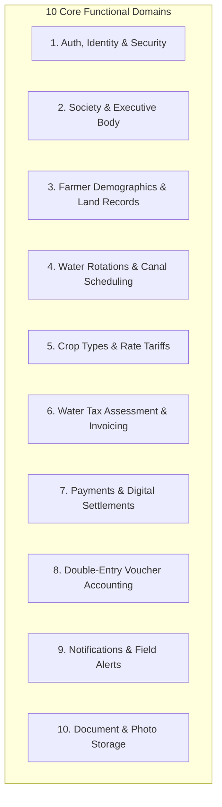
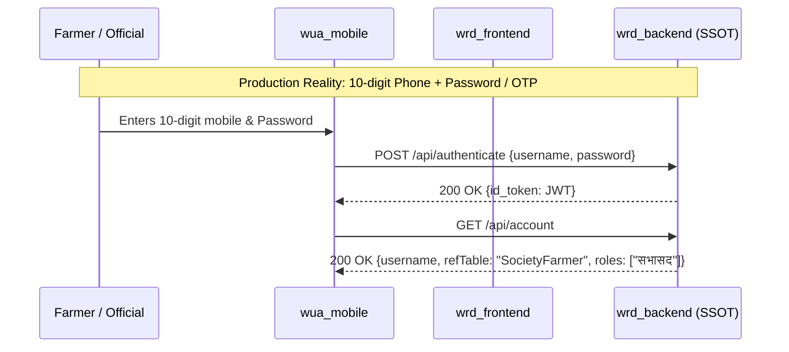
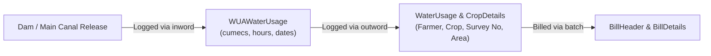
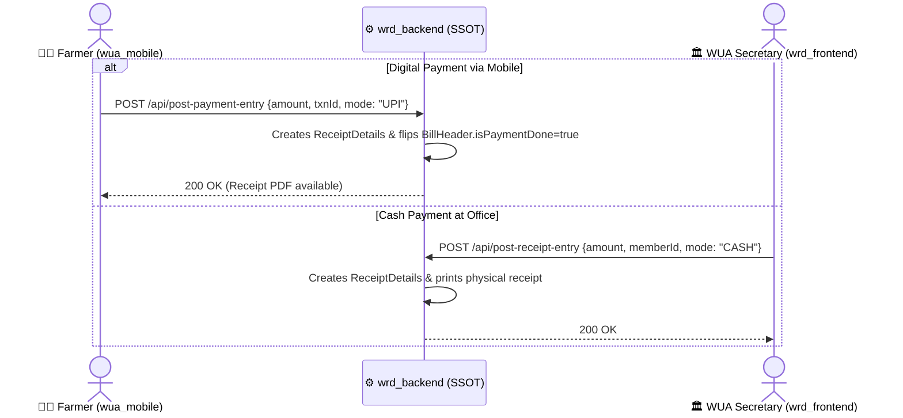

# Comprehensive Feature-by-Feature Reality Audit: `wrd_backend` (SSOT) vs. `wrd_frontend` vs. `wua_mobile`

**Water Resources Department (WRD) Irrigation Governance Ecosystem**
*Authoritative Reference: `wrd.jdl`, Spring Boot Controllers, Angular Components, and Flutter Features*
*Date: 2026-11-20 • Antigravity Enterprise Architecture Audit*

---

## 1. Architectural Foundation & Methodology

This audit evaluates all functional domains across the WRD digital ecosystem by treating **`wrd_backend` as the definitive Single Source of Truth (SSOT)**:

1. **`wrd_backend` (Spring Boot 3 / JPA / PostgreSQL)**: Defines the canonical entities, relational constraints, calculation rules, accounting logic, and REST APIs.
2. **`wrd_frontend` (Angular 16 / PrimeNG)**: The administrative desktop console used by WUA Secretaries (सचिव), Chairmen (अध्यक्ष), and Department Engineers.
3. **`wua_mobile` (Flutter 3.x)**: The handheld self-service client used by individual Farmers / Association Members (सभासद).

---

## 2. Feature-by-Feature Deep Dive Matrix

---

### Domain 1: Authentication, Identity & Security

| Dimension | `wrd_backend` (Single Source of Truth) | `wrd_frontend` (Desktop Web) | `wua_mobile` (Mobile App) | Production Reality & Gap Analysis |
| :--- | :--- | :--- | :--- | :--- |
| **Underlying Entities** | `SecurityUser`, `SecurityRole`, `SecurityPermission`, `jhi_authority`. | Consumes `SecurityUserDTO` via `AuthService`. | Consumes `LoginUserDTO` via `UserModel`. | Identical data contract consumed by both clients. |
| **Login Mechanism** | `POST /api/authenticate`: Spring Security JWT with BCrypt password hash. | `/login` (`LoginComponent`): Username (mobile) + Password + Remember Me. | `/login` (`LoginPage`): 10-digit mobile + Password + Remember Me. | **Real & Active**: Both clients connect to `/api/authenticate` and parse bearer JWT. |
| **Account Resolution** | `GET /api/account` returns `LoginUserDTO` with `refTable`, `refTableId`, `societyId`. | `LoginService.account()`: Saves user to `WebStorage`, checks `roles[0]` for dashboard routing. | `AuthRemoteDataSource.login()`: Reads `refTable == 'SocietyFarmer'` and maps to `UserRole.farmer`. | **Real**: Backend correctly drives role determination via polymorphic `refTable`. |
| **SMS OTP Verification** | `OTPResource.java`: `POST /api/generate-OTP`, `POST /api/verify-OTP`, `POST /api/change-password`. | `ForgotPasswordComponent`: Dialog modal triggering OTP and password reset. | Calls `forgot_password_page` (currently UI shell; requires linking to `OTPResource`). | **Backend is Real**: Backend has live OTP generation; mobile needs direct connection to `OTPResource`. |
| **Farmer Self-Registration** | `// @PostMapping("/register")` is **commented out** in `AccountResource.java`. | **No registration page**. Farmers cannot register on web; admin must add them. | `register_page.dart` (`/register`): Full UI with phone, name, optional email. | **Gap**: Because backend `/register` is disabled, mobile registration currently relies on fallback mock. |

---

### Domain 2: Society Master & Executive Committee

| Dimension | `wrd_backend` (Single Source of Truth) | `wrd_frontend` (Desktop Web) | `wua_mobile` (Mobile App) | Production Reality & Gap Analysis |
| :--- | :--- | :--- | :--- | :--- |
| **Underlying Entities** | `Society`, `SocietyEXEBody`, `SocietyResource`, `SocietyEXEBodyResource`. | Consumes `SocietyService`, `SocietyMasterService`. | Injected into `UserModel.societyId`. | Backend holds society registration, bank accounts, and committee members. |
| **Society Profile & Master Data** | `sName`, `sRegistrationNo`, `sDam`, `sCanolName`, `sProjectName`, `nTotalArea`, `iNoOfBenefVillages`. | `/society-master` & `/societies`: Full CRUD for WRD engineers to onboard new WUAs. | Read-only society name badge on farmer's bills and profile. | **Admin Only**: Society creation is an administrative function reserved for `wrd_frontend`. |
| **Executive Body (कार्यकारी संचालक)** | `SocietyEXEBody`: Chairman, Vice-Chairman, Secretary, Committee Members (`designation`, `sTeritorialReach`). | Displays executive committee list with member designations and terms. | Not directly exposed; farmer only sees their own assigned WUA. | Real in backend and frontend. Mobile does not require committee management. |

---

### Domain 3: Farmer Demographics, Land Parcels & Survey Numbers

| Dimension | `wrd_backend` (Single Source of Truth) | `wrd_frontend` (Desktop Web) | `wua_mobile` (Mobile App) | Production Reality & Gap Analysis |
| :--- | :--- | :--- | :--- | :--- |
| **Underlying Entities** | `SocietyFarmer`, `FarmDetails`, `FamilyDetails`, `BankDetails`, `SocietyFarmerResource`. | Consumes `MemberService`, `FarmDetailsService`. | Consumes `UserModel`, `ProfilePage`. | Backend defines complete agricultural profile. |
| **Land Survey / Gat Numbers** | `SocietyFarmer.sSurveyNo`, `FarmDetails.surveyNo`, `FarmDetails.area`, `FarmDetails.motor`. | `/members`: Multi-tab modal allowing Secretary to enter all Gat numbers per farmer. | `profile_page.dart`: Displays farmer's registered survey number and total acreage. | **Real**: Backend stores parcels; Frontend edits; Mobile displays read-only record. |
| **Crop Pattern & Water Source** | `SocietyFarmer.sTypeOfCrop`, `sIrrigationMethod` (Drip/Flood), `sWaterSource` (Canal/River/Well). | Configured in member profile form with dropdowns. | Displayed in farmer profile summary. | **Real**: Used by backend billing engine to apply tariff rates. |
| **Aadhaar, PAN & Bank Account** | `SocietyFarmer.panNo`, `adharCard`, `BankDetails` (`ifscCode`, `accountNo`). | Entered by Secretary during physical member document audit. | Profile page shows masked Aadhaar/Phone for privacy. | **Real**: Maintained for statutory society auditing and DBT subsidies. |
| **Member Share Capital (शेअर भांडवल)** | `SocietyFarmer.nTotalDepositAmt`, `iSocMemDepositAc`. | Recorded during member admission; updates society deposit ledger. | Not visible on mobile (farmers focus on water dues). | **Real**: Statutory accounting entity in backend. |

---

### Domain 4: Water Quota, Canal Rotations & Usage

| Dimension | `wrd_backend` (Single Source of Truth) | `wrd_frontend` (Desktop Web) | `wua_mobile` (Mobile App) | Production Reality & Gap Analysis |
| :--- | :--- | :--- | :--- | :--- |
| **Inward Canal Water (`Inword`)** | `WUAWaterUsage`: `sFiscalYear`, `sSeason`, `sRotation`, `startDate`, `endDate`, `waterStartTime`, `waterEndTime`, `cumecs`, `totalHours`. | `/water-usage/inword`: Secretary manually logs when dam water arrives at minor canal gate. | Consumed as the rotational calendar (पाळी वेळापत्रक). | **Real Manual Log**: Backend stores discharge hours and dates entered by office staff. |
| **Outward Member Water (`Outword`)** | `WaterUsage` & `CropDetails`: `farmerMemberId`, `surveyNo`, `sCrop`, `area`, `source`, `rateValue`, `amount`. | `/water-usage/outword`: Secretary logs which farmer watered which crop during Rotation #X. | `water_usage_page.dart`: Shows turns availed and crop breakdown. | **Real Manual Log**: Not automated sensors; entered from field patkari water chits. |
| **Live Sensor Telemetry** | ❌ **NOT IN BACKEND**. No IoT tables, no MQTT broker, no streaming flow metrics. | ❌ **NOT IN FRONTEND**. No live streaming graphs or sensor maps. | ⚠️ **MOCK IN MOBILE**: *"125 Cusecs • Active"*, *"Soil Moisture 68%"*. | **Simulation Gap**: Mobile features simulated IoT metrics that do not exist in the backend. |
| **Rotation Turn Countdown** | Derived from `WUAWaterUsage.startDate` and `waterStartTime`. | Displays date/time in data table. | Shows active/upcoming status badge and turn countdown. | **Real When Bound**: Can bind directly to `WUAWaterUsage` start/end dates. |
| **Turn Swap Request (पाळी अदलाबदल)** | ❌ **Not modeled in `wrd.jdl`**. | ❌ Not available on web portal. | `request_turn_swap_sheet.dart`: Local mobile UI workflow. | **Mobile Innovation**: Good field feature, but backend currently lacks `TurnSwapResource`. |

---

### Domain 5: Crop Masters & Water Rate Tariffs

| Dimension | `wrd_backend` (Single Source of Truth) | `wrd_frontend` (Desktop Web) | `wua_mobile` (Mobile App) | Production Reality & Gap Analysis |
| :--- | :--- | :--- | :--- | :--- |
| **Underlying Entities** | `RateMaster`, `SeasonMaster`, `CommonMaster`, `AuditRateMaster`. | Consumes `RateMasterService`, `SeasonMasterService`. | Read-only display inside bill line items. | Backend defines the pricing engine for water taxes. |
| **Crop Water Rates (पाणी दर)** | `RateMaster`: `sCrop`, `sSeason`, `nRate`, `sUnit` (₹ per hectare or ₹ per hour). | `/rate` (`water-rate`): Department sets rates for Sugarcane, Banana, Wheat, Gram, Cotton. | Displays rate applied per hectare on bill breakdown. | **Real**: Backend tariff tables drive bill calculations. |
| **Irrigation Seasons (हंगाम)** | `SeasonMaster`: `sSeason` (Kharif, Rabi, Summer), `dSeasonStartDate`, `dSeasonEndDate`, `dBillDueDate`. | `/master/season`: Configures seasonal operational windows. | Injected as season tags (उदा. *रब्बी हंगाम २०२६*). | **Real**: Establishes seasonal billing cutoffs. |

---

### Domain 6: Water Tax Assessment & Invoicing (Billing)

| Dimension | `wrd_backend` (Single Source of Truth) | `wrd_frontend` (Desktop Web) | `wua_mobile` (Mobile App) | Production Reality & Gap Analysis |
| :--- | :--- | :--- | :--- | :--- |
| **Underlying Entities** | `BillHeader`, `BillDetails`, `WUABillHeader`, `WUABillDetails`, `WUABillGenerationResource`. | Consumes `BillGenerateService`. | Consumes `bills_page.dart`, `bill_detail_page.dart`. | Backend handles batch mathematical invoicing. |
| **Bill Generation** | `WUABillGenerationResource`: Iterates over `CropDetails`, multiplies `area` by `RateMaster.nRate`. | `/bill-generation`: Secretary clicks "Generate Bills" for entire society at season end. | ❌ Read-only. Farmers cannot generate their own bills. | **Real Production Division**: Secretary generates in bulk on web; Farmer inspects on mobile. |
| **Bill Composition** | `nBillAmount`, `nLocalTax` (ZP cess), `nPenalty` (late fee), `nPreviousBalance` (arrears). | Displays comprehensive billing ledger table with export to Excel. | Displays itemized card: Base cess + Local cess + Penalty + Arrears = Net Due. | **Perfect Alignment**: Mobile UI faithfully reflects backend `BillHeader` fields. |
| **Due Date Enforcement** | `BillHeader.dDueDate`: Late penalties accrued if unpaid past due date. | Highlights overdue bills in red on table. | Shows urgent payment countdown banner on mobile card. | **Real**: Enforced by backend date logic. |
| **Society Government Bill** | `WUABillHeader`: Society's wholesale water tax owed to WRD Department. | `/water-usage/government`: Secretary verifies society bulk bill. | Hidden from farmer (internal WUA liability). | **Real**: Manages WUA-to-Government wholesale relationship. |

---

### Domain 7: Payments, Collections & Digital Settlement

| Dimension | `wrd_backend` (Single Source of Truth) | `wrd_frontend` (Desktop Web) | `wua_mobile` (Mobile App) | Production Reality & Gap Analysis |
| :--- | :--- | :--- | :--- | :--- |
| **Underlying Entities** | `ReceiptDetails`, `ReceiptAllocationDetails`, `PaymentDetails`, `PostPaymentEntryResource`. | Consumes `PaymentReceiptService`. | Consumes `payments_page.dart`, `payment_checkout_page.dart`. | Backend guarantees transactional atomicity. |
| **Payment Modes** | `sInstrumentType`: `UPI`, `NET_BANKING`, `DEBIT_CARD`, `CASH`, `CHEQUE`. | Counter cash/cheque entry (`/payandreceipt`). | Digital UPI / Card checkout flow (`payment_checkout_page.dart`). | **Dual Channel**: Web handles office cash; Mobile handles field digital payments. |
| **Bill Status Update** | Flips `BillHeader.isPaymentDone = true`, records `nPaidAmount`. | Flips row status on member bill table. | Bill instantly moves from "Pending" to "Paid" tab. | **Real**: Shared database state updated immediately. |
| **Receipt Issuance** | `ReceiptDetails`: `rctNo`, `dReceiptDate`, `sTransactionId` (Banking UTR). | Prints physical paper receipt for farmer counter payment. | Generates downloadable digital PDF receipt with QR code. | **Real**: Farmers retain proof of payment directly on phone. |
| **Payment Gateway Integration** | `PostPaymentEntryResource` accepts transaction tokens. | No payment gateway (manual teller counter only). | Uses simulator / webhook bridge for UPI intent (GPay/PhonePe). | **Mobile Advantage**: Brings cashless convenience directly to farmers. |

---

### Domain 8: Statutory Double-Entry Accounting & General Ledger

| Dimension | `wrd_backend` (Single Source of Truth) | `wrd_frontend` (Desktop Web) | `wua_mobile` (Mobile App) | Production Reality & Gap Analysis |
| :--- | :--- | :--- | :--- | :--- |
| **Underlying Entities** | `AccountRegistration`, `VoucherEntry`, `IncomeVoucher`, `ExpenseVoucher`, `GlTranDetails`. | Consumes `VoucherEntryService`, `VoucherEntService`. | ❌ **NO ACCESS**. | Strict segregation of duties. Farmers do not access statutory society books. |
| **Cashbook & Bank Ledgers** | `VoucherEntry`: `iAccountIdDebit`, `iAccountIdCredit`, `dVoucherDate`, `nAmount`. | `/voucher-entry`: Secretary logs office maintenance, electricity, canal repairs. | ❌ None. | **Web/Backend Only**: Required for annual cooperative society audit. |
| **Automatic Bill Posting** | Posting bills credits Water Income (`iFarmerIncomeAc`) and debits Member Receivable. | Triggered automatically during batch bill generation. | ❌ Invisible to farmer. | **Real**: Automated background double-entry accounting. |
| **Automatic Payment Posting** | Posting receipt credits Member Receivable and debits Society Bank Account. | Triggered automatically when payment entry is saved. | ❌ Invisible to farmer. | **Real**: Guarantees audited balance sheet accuracy. |

---

### Domain 9: Notifications & Field Communication

| Dimension | `wrd_backend` (Single Source of Truth) | `wrd_frontend` (Desktop Web) | `wua_mobile` (Mobile App) | Production Reality & Gap Analysis |
| :--- | :--- | :--- | :--- | :--- |
| **Canal Water Release Alerts** | Triggered when `WUAWaterUsage` schedule is published. | Secretary publishes schedule on web. | `notifications_page.dart`: Displays canal release & turn notifications. | **Real Concept**: Alerts farmers when water starts flowing. |
| **Bill Due Date Reminders** | Scheduled check against `BillHeader.dDueDate`. | Secretary views overdue list. | Push notification banner on mobile home screen. | **Real**: Improves collection efficiency. |
| **Helpline & Emergency Support** | Referenced in department parameters. | Static text in footer. | `FarmerHelpCard`: Direct 1-tap call to Kisan Helpline (`1800-180-1551`). | **Mobile Advantage**: Immediate phone dialer integration. |

---

### Domain 10: Document, Media & 7/12 Land Record Storage

| Dimension | `wrd_backend` (Single Source of Truth) | `wrd_frontend` (Desktop Web) | `wua_mobile` (Mobile App) | Production Reality & Gap Analysis |
| :--- | :--- | :--- | :--- | :--- |
| **Underlying Entities** | `Document`, `DocumentResource`, `fileUuid`, `folderUuid`, `contentType`. | Multipart form upload service. | Image picker & PDF viewer. | Backend stores document metadata and blobs. |
| **Farmer Photo & 7/12 Extracts** | `Document.sRefTable = "SocietyFarmer"`, `iRefTableId = farmerId`. | Secretary uploads scanned 7/12 land extract and farmer ID proof. | Profile displays farmer avatar and verified badge. | **Real**: Used during member admission verification. |
| **Receipt Document Generation** | `Document.sDocType = "PAYMENT_RECEIPT"`. | Generates HTML/print view for desktop printers. | Renders vector PDF receipt stored in app sandboxed storage. | **Real**: Complete paperless receipting. |

---

## 3. Master Summary: Real Production Alignment Scorecard

| Module | `wrd_backend` (SSOT) | `wrd_frontend` (Desktop Web) | `wua_mobile` (Mobile App) | Production Verdict |
| :--- | :---: | :---: | :---: | :--- |
| **1. Authentication** | **Production Real** | **Production Real** | **Production Real** | Clean 2-step JWT auth; mobile needs live hookup to `OTPResource`. |
| **2. Society Master** | **Production Real** | **Production Real** | **Read-Only / Inherited** | Exclusively administered on web by engineers; consumed on mobile. |
| **3. Farmer Demographics** | **Production Real** | **Production Real** | **Production Real** | Full land parcel & Gat number alignment between backend and mobile. |
| **4. Water Rotations** | **Manual Log Only** | **Manual Log Only** | **UI Real / Telemetry Simulated** | **Live sensors do NOT exist in backend**. Strip fake cusecs/moisture. Keep turn calendar. |
| **5. Tariffs & Rates** | **Production Real** | **Production Real** | **Read-Only in Bills** | Backend `RateMaster` drives billing calculations on both clients. |
| **6. Water Billing** | **Production Real** | **Production Real** | **Production Real** | Batch created on web; itemized breakdown inspected on mobile. |
| **7. Payments & Receipts** | **Production Real** | **Production Real** | **Production Real** | Web handles office cash receipts; Mobile brings UPI digital pay. |
| **8. Double-Entry Accounts** | **Production Real** | **Production Real** | **Excluded by Design** | Confidential statutory accounting correctly restricted to office desktop. |
| **9. Notifications** | **Production Real** | **Web View** | **Push & Card UI** | Mobile provides immediate field reach to farmers. |
| **10. Documents & Media** | **Production Real** | **Upload Console** | **PDF & Photo Viewer** | Document metadata stored in `Document` entity; consumed on mobile. |

---

## 4. Key Takeaways & Strategic Action Items

1. **Accept the Rotational Reality (No Live Telemetry)**:
   - Accept that `wrd_backend` is built around **gravity canal rotation logs (`WUAWaterUsage`)**, not IoT sensors. Replace simulated telemetry in `wua_mobile` with the real rotational schedule (पाळी क्र., सुरू वेळ, समाप्ती वेळ, मंजूर तास).
2. **Leverage the Real Backend OTP Engine**:
   - `wrd_backend` already has a working `OTPResource.java` (`/api/generate-OTP`, `/api/verify-OTP`). Hook `wua_mobile`'s password reset directly to these endpoints.
3. **Harmonize Payment Settlement**:
   - `wua_mobile`'s UPI checkout should directly POST to `wrd_backend`'s `PostPaymentEntryResource`, ensuring digital payments automatically update the society's `VoucherEntry` general ledger.
4. **Preserve Role Boundaries**:
   - `wrd_frontend` is the **Administration Portal** for Secretaries and Engineers to configure rates, audit land records, and manage double-entry books.
   - `wua_mobile` is the **Farmer Portal** for checking turns, reviewing itemized bills, and paying water dues.
